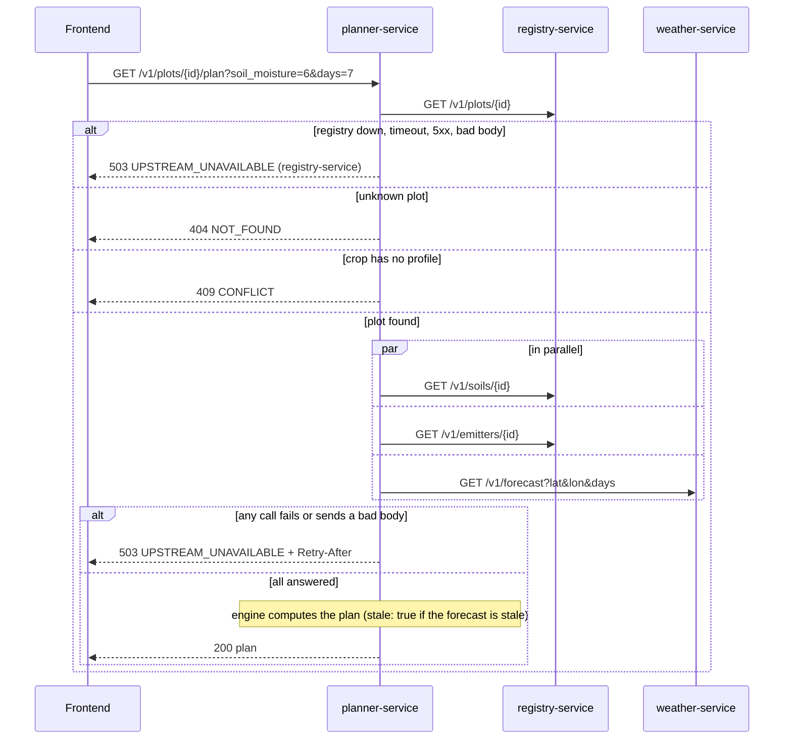

# planner-service

The planner turns a plot (from the registry-service) and its forecast (from the weather-service) into an irrigation plan for the next 1 to 7 days: whether to water today, and for how many minutes each day. It keeps no state between requests.

## Prerequisites

Python 3.12 and [uv](https://docs.astral.sh/uv/). The registry-service (port 8000) and the weather-service (port 8001) must be running. The tests need neither.

## Run locally (from `services/planner-service`)

```bash
cp .env.example .env
uv sync
uv run uvicorn main:app --host 127.0.0.1 --port 8002
uv run pytest
```

Swagger UI: http://127.0.0.1:8002/docs

## Endpoints

| Endpoint | What it does |
|---|---|
| `GET /v1/plots/{id}/plan?soil_moisture={0..10}&days={1..7}` | The plan. `soil_moisture` is required, a whole number: 0 = soil completely dry or first planting, 10 = full. `days` defaults to 7. Bad or missing values: 422 `VALIDATION`. |
| `GET /health` | `{"status": "ok"}`. Calls nothing: it says this service is up, not that its upstreams are. |

Errors are `application/problem+json` with a `code`:

| Status | `code` | When |
|---|---|---|
| 422 | `VALIDATION` | `days` or `soil_moisture` missing, not a whole number, or out of range. |
| 404 | `NOT_FOUND` | The registry does not know the plot. |
| 409 | `CONFLICT` | The plot's crop has no entry in `crop_profiles.json` (a data gap, not a server bug). |
| 503 | `UPSTREAM_UNAVAILABLE` | The registry-service or weather-service is down, too slow, answered 5xx, or sent a body we cannot use. `detail` names the service. `Retry-After` is the weather-service's own when it sent one, else `RETRY_AFTER_S`. Never a plan of zeros. |

## Example

`GET /v1/plots/{id}/plan?soil_moisture=6&days=3`: tomato, 1000 m², day 80 after planting (the hand-checked case A):

```json
{
  "plot_id": "p1",
  "plot_name": "North block",
  "crop": "tomato",
  "soil_moisture_input": 6,
  "generated_at": "2026-11-18T06:00:00Z",
  "forecast_fetched_at": "2026-11-18T03:00:00Z",
  "season_ended": false,
  "warnings": [],
  "today": { "date": "2026-11-18", "irrigate": true, "run_minutes": 832 },
  "assumptions": {
    "root_depth_m": 0.3,
    "soil_capacity_mm": 52.5,
    "irrigate_when_depleted_pct": 30,
    "uniformity_factor": 1.1,
    "emitters": 1666.67,
    "system_flow_lph": 1666.67,
    "climate_adjustment": { "wind_2m_ms": 2.0, "rh_min_pct": 45.0, "kc_change": 0.0 }
  },
  "days": [
    { "date": "2026-11-18", "stage": "mid", "et0_mm": 5.0, "rain_mm": 0.0, "kc": 1.15, "need_mm": 5.75,
      "irrigation_mm": 21.0, "litres": 23100, "run_minutes": 832, "soil_water_end_mm": 46.75,
      "soil_water_end_pct": 89.05, "stale": false, "reason": "Irrigate: depletion reached 30% of soil capacity" },
    { "date": "2026-11-19", "stage": "mid", "et0_mm": 5.0, "rain_mm": 0.0, "kc": 1.15, "need_mm": 5.75,
      "irrigation_mm": 0.0, "litres": 0, "run_minutes": 0, "soil_water_end_mm": 41.0,
      "soil_water_end_pct": 78.1, "stale": false, "reason": "No irrigation: depletion below 30% of soil capacity" },
    { "date": "2026-11-20", "stage": "mid", "et0_mm": 5.0, "rain_mm": 0.0, "kc": 1.15, "need_mm": 5.75,
      "irrigation_mm": 0.0, "litres": 0, "run_minutes": 0, "soil_water_end_mm": 35.25,
      "soil_water_end_pct": 67.14, "stale": false, "reason": "No irrigation: depletion below 30% of soil capacity" }
  ],
  "totals": { "litres": 23100, "run_minutes": 832 }
}
```

## How each field is computed

All irrigation numbers come from [`engine.py`](engine.py), a pure module (no HTTP, no clock, no files), following the project skill [`irrigation-calc-reference`](../../.claude/skills/irrigation-calc-reference/SKILL.md) (`references/formulas.md` has every equation). Crop values (Kc, height, stage lengths) come only from [`crop_profiles.json`](crop_profiles.json). No AI model computes or adjusts a number.

| Field | How |
|---|---|
| `days[].date`, `et0_mm`, `rain_mm` | The forecast, as the weather-service sent it (rounded to 2 decimals). The first day is today at the plot. |
| `stage`, `kc` | Days since planting against the crop's default stage row: init, dev, mid, late, `ended`. Kc is linear in dev and late (FAO Eq. 66). Kc mid and Kc end get the climate adjustment (Eq. 62, 65). |
| `assumptions.climate_adjustment` | Average wind (10 m converted to 2 m by Eq. 47, clamped 1-6 m/s) and average minimum humidity (clamped 20-80 %) over the plan days. `kc_change` is the term added to Kc mid and Kc end. |
| `need_mm` | `kc x et0_mm` |
| `assumptions.root_depth_m`, `soil_capacity_mm` | Drip root depth: 0.10 m at planting, linear to 0.30 m at the end of dev. Capacity = the soil's mm per m x depth. Today's values. |
| `irrigation_mm` | Each day: rain counts only if `rain >= 0.2 x ET0` (it lowers depletion, the excess is lost). Then, if depletion >= 30 % of capacity, irrigate back to full. Then `need_mm` is added to depletion. The first day starts at `capacity x (1 - soil_moisture/10)`. |
| `litres` | `irrigation_mm x area_m2 x UNIFORMITY_FACTOR` (nearest litre). Rain is not multiplied. |
| `run_minutes` | `ceil(litres / (emitters x flow_lph) x 60)`, where `emitters = area / (row spacing x emitter spacing)`. 0 without irrigation. |
| `soil_water_end_mm`, `_pct` | Capacity minus depletion at the end of the day, and as % of that day's capacity. |
| `stale`, `warnings` | `stale` is the weather-service's flag, on every day. `STALE_FORECAST` then appears in `warnings`. `SEASON_ENDED` appears when today is past the crop's usual season length; the plan is still returned, with Kc end. |
| `forecast_fetched_at` | When the forecast was fetched from the provider. The frontend can show its age. |
| `totals` | Sums of the daily rounded litres and minutes. |

Rounding: mm, Kc and % to 2 decimals, litres to the nearest whole, minutes always up. Full precision is kept inside the calculation.

## Upstream calls and failures

One call per upstream per request, no retries: the weather-service is the only retry point in the chain (3 attempts, 4 s budget). The planner waits `REGISTRY_TIMEOUT_S` (1.0 s) for the registry and `WEATHER_TIMEOUT_S` (4.5 s) for the weather-service, a bit above the weather-service's own budget, so its stale answer arrives before we give up.



## Settings (`.env`, read only by `config.py`)

| Variable | Default | Meaning |
|---|---|---|
| `REGISTRY_URL` | required | Base URL of the registry-service, e.g. `http://127.0.0.1:8000`. |
| `WEATHER_URL` | required | Base URL of the weather-service, e.g. `http://127.0.0.1:8001`. |
| `REGISTRY_TIMEOUT_S` | `1.0` | Seconds to wait for one registry answer. |
| `WEATHER_TIMEOUT_S` | `4.5` | Seconds to wait for the weather answer. |
| `RETRY_AFTER_S` | `30` | `Retry-After` on a 503 when the failed service sent none. |
| `UNIFORMITY_FACTOR` | `1.1` | Drip non-uniformity: multiplies irrigation litres only. Must be 1 or more. |
| `CROP_PROFILES_PATH` | `crop_profiles.json` next to `config.py` | Crop values file. |

A missing or invalid variable, or a bad crop file, stops the service at startup with a message naming it (never its value).

## Tests

`uv run pytest`. No network: the registry and weather-service are an `httpx.MockTransport`, time is frozen with time-machine. `tests/test_engine.py` reproduces the three hand-calculated cases of the skill (`references/decisions.md`) field by field.
