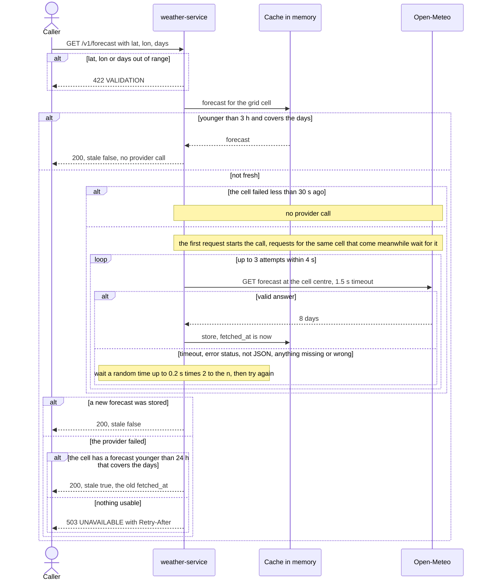

# weather-service

The weather service gives AgroPilot the daily forecast for a point: ET0 and rain, in mm, for the next 1 to 7 days. It gets the numbers from [Open-Meteo](https://open-meteo.com/en/docs) (the provider), keeps them in memory, and serves them over HTTP. It knows coordinates and dates only: nothing about farms, plots or crops.

## Prerequisites

Python 3.12 (from [`../../.python-version`](../../.python-version)) and [uv](https://docs.astral.sh/uv/). Running the service needs internet access to the provider. The tests need none.

## Run locally (from `services/weather-service`)

```bash
cp .env.example .env
uv sync
uv run uvicorn main:app --host 127.0.0.1 --port 8001
```

Swagger UI: http://127.0.0.1:8001/docs

## Endpoints

| Endpoint | What it does |
|---|---|
| `GET /v1/forecast?lat={lat}&lon={lon}&days={days}` | The forecast for a point: `days` days, starting today at the point. All three parameters are required. `lat` from -90 to 90, `lon` from -180 to 180, `days` from 1 to 7. Anything else: 422, `code` `VALIDATION`. |
| `GET /health` | `{"status": "ok"}`. It never calls the provider: it says this service is up, not that Open-Meteo is. |

`GET /v1/forecast?lat=31.25&lon=34.79&days=3` (the numbers are from a real Open-Meteo answer):

```json
{
  "lat": 31.25,
  "lon": 34.79,
  "source": "open-meteo",
  "fetched_at": "2026-11-17T22:04:57Z",
  "stale": false,
  "days": [
    { "date": "2026-11-18", "et0_mm": 2.73, "rain_mm": 0.0 },
    { "date": "2026-11-19", "et0_mm": 2.97, "rain_mm": 0.0 },
    { "date": "2026-11-20", "et0_mm": 3.15, "rain_mm": 0.0 }
  ]
}
```

- `lat`, `lon`: as requested, not the grid cell's centre.
- `fetched_at`: when the forecast was fetched from the provider, in UTC. It changes only when the provider is called, so a caller can show how old the forecast is.
- `stale`: `true` only when the provider failed and this is the last forecast the service had for the cell.
- `days[].date`: the local date at the point. The first one is today there, so a forecast fetched late in the evening in UTC can start on the next date (as above).
- `et0_mm`, `rain_mm`: millimetres of water per day.

## How a request is answered

The earth is cut into 0.1° grid cells. Points in one cell share one forecast. The cell key is `(floor(lat * 10 + 1e-9), floor(lon * 10 + 1e-9))`, whole numbers; the tiny epsilon keeps a computed coordinate such as `0.7999999999999999` in the cell of `0.8`. The provider is asked about the cell's centre, clamped to the valid range (so lat 90 and lon 180 work).

| Situation | Answer |
|---|---|
| The cell's forecast is younger than 3 h (`FRESH_FOR_S`) and covers today + `days` | `200`, `stale: false`. No provider call. |
| Older, and the provider answers | `200`, `stale: false`, a new `fetched_at`. |
| Older, the provider fails (3 attempts), and the cell has a forecast younger than 24 h (`MAX_STALE_S`) that still covers today + `days` | `200`, `stale: true`, the old `fetched_at`. |
| The provider fails and there is no such forecast | `503`, `code` `UNAVAILABLE`, `Retry-After`. |
| The cell failed less than 30 s ago (`FAILURE_COOLDOWN_S`) | The two answers above for a failure, at once, without a provider call. `Retry-After` is what is left of the 30 s. |

- **Same time, same cell:** concurrent requests for one cell share one provider call. All of them get its outcome (fresh, stale or 503); none starts retries of its own.
- **Memory only:** forecasts are kept in the memory of the process, one per cell. At most 10,000 cells (`CACHE_MAX_CELLS`): the least recently requested one goes first. A forecast older than 24 h can never be served, so it is deleted. A restart empties the cache; the next request fetches again. Each extra worker process would have its own cache.
- **Every request gets the days from today at the point.** The service fetches 8 days each time (`FORECAST_FETCH_DAYS`) and cuts the `days` asked for, starting at today's local date, so a forecast up to 24 h old still covers 7 days from today.

## The provider: Open-Meteo

| Open-Meteo daily variable | Unit | Becomes |
|---|---|---|
| `et0_fao_evapotranspiration` | mm per day | `et0_mm`. The reference evapotranspiration of a well-watered grass field (FAO-56 Penman-Monteith): how much water a standard patch of grass loses to sun and wind that day. |
| `rain_sum` + `showers_sum` | mm per day | `rain_mm`. `rain_sum` is rain from large-scale weather systems, `showers_sum` is convective rain (showers). Together: the liquid water that reaches the soil. |

Why not `precipitation_sum`: it includes snowfall. In a system for the whole world, snow does not reach the soil that day. Why not `rain_sum` alone: it leaves out showers, which matter in warm climates. They are separate numbers: in the real answer used for the example above, one day has `showers_sum` 0.15 mm and `rain_sum` 0.0 mm. The sum is rounded to 2 decimals, only to remove float noise such as `0.2 + 0.1` (the provider's values have 1 or 2 decimals).

The service always sends `daily=et0_fao_evapotranspiration,rain_sum,showers_sum`, `timezone=auto` (days are local days at the point, anywhere in the world), `precipitation_unit=mm` and `forecast_days=8`, plus `apikey` when `OPEN_METEO_API_KEY` is not empty. Open-Meteo's names and units appear in `provider.py` only.

**Nothing is guessed (FR-2.8).** Each of these is a provider failure, never a default, never a zero: a timeout, an error status, a body that is not JSON, a missing field, any `null`, a value that is not a number or is negative, a unit that is not `mm`, lists that differ in length or are not 8 days, dates that are not consecutive days. If a point gets `null` values from the provider, that point gets stale data or a 503.

## Retries and time

A fetch is up to 3 attempts (2 retries). Each attempt is cut off after 1.5 s (`PROVIDER_TIMEOUT_S`). Before retry number `n` (0, 1) the service waits a random time between 0 and `0.2 × 2^n` s (full jitter). All attempts and waits together stay within 4 s (`PROVIDER_TOTAL_BUDGET_S`): a retry that could not get at least half a timeout is not started, and the last attempt gets only the time that is left.

**This service is the only place in AgroPilot that retries.** A caller must not retry it: call it once, with a timeout a bit above 4 s (for example 5 s). Retries on top of retries multiply the load on the provider and the wait of the grower.

## The oldest forecast that is served: 24 hours

A forecast older than 24 h (`MAX_STALE_S`) is never served, not even as `stale: true`. The service answers `503` instead.

Why 24 h: in a UC Davis study of ET0 forecasts ([Peddinti, National Blend of Models, eScholarship](https://escholarship.org/uc/item/6sb9r80k)) the forecast error (RMSE) was 0.70, 0.79 and 0.95 mm/day at 1, 3 and 7 days ahead. Each extra day of lead adds only about 0.04 mm/day. A forecast that is one day old is, for any day, a forecast with one more day of lead, so its error is small next to the 0.7 to 0.95 mm/day the grower already accepts. Older than that the numbers are no longer today's forecast: the first days are in the past, and there is no longer a forecast for day 7. A caller should show `fetched_at` as the age of the forecast and warn more strongly when it is older than 6 h.

## Configuration (`.env`)

The settings are read in `config.py` (pydantic-settings), from the environment or from a `.env` file next to `config.py`. Copy the example to start: `cp .env.example .env`. A real environment variable beats `.env`. `OPEN_METEO_BASE_URL` is required, with no default: if it is missing or is not an http(s) URL, the service refuses to start and names the variable. The API key is never printed or logged. `.env` is for local use only; do not commit it.

| Variable | Default | Meaning |
|---|---|---|
| `OPEN_METEO_BASE_URL` | none (required) | The provider's forecast URL. Free tier: `https://api.open-meteo.com/v1/forecast`. A paid plan uses the customer endpoint (`customer-api.open-meteo.com`, same path). |
| `OPEN_METEO_API_KEY` | empty | Sent as `apikey` when not empty. Empty means the free tier. |
| `PROVIDER_TIMEOUT_S` | `1.5` | One attempt, in seconds. |
| `PROVIDER_RETRIES` | `2` | Retries after the first attempt. |
| `BACKOFF_BASE_S` | `0.2` | Retry `n` waits a random time between 0 and `BACKOFF_BASE_S × 2^n` seconds. |
| `PROVIDER_TOTAL_BUDGET_S` | `4` | All attempts and waits together, in seconds. |
| `FRESH_FOR_S` | `10800` | How long a forecast is fresh (3 h). |
| `MAX_STALE_S` | `86400` | The oldest forecast that is served as stale (24 h). |
| `FAILURE_COOLDOWN_S` | `30` | After a cell failed, the provider is left alone for it this long. |
| `CACHE_MAX_CELLS` | `10000` | Grid cells kept in memory. |
| `FORECAST_FETCH_DAYS` | `8` | Days asked from the provider each time (7 to 16). |

## Errors

All errors are `application/problem+json` (RFC 9457) with a `code` of `VALIDATION`, `NOT_FOUND` or `UNAVAILABLE`; 503 responses include `Retry-After`.

## Tests

From `services/weather-service`: `uv run pytest`. The tests never reach the internet: the provider is replaced with `httpx.MockTransport`, and time is frozen with time-machine. They ignore `.env`.

## Flow



Design decisions and their reasons: [../../docs/judgment-log.md](../../docs/judgment-log.md)
